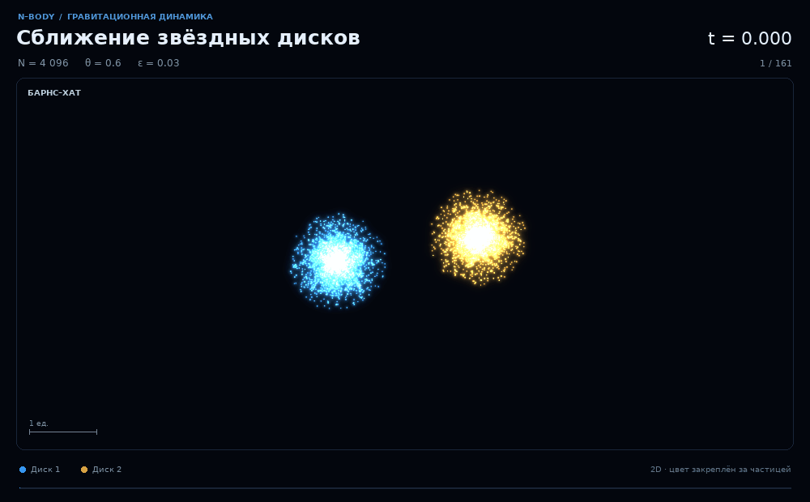
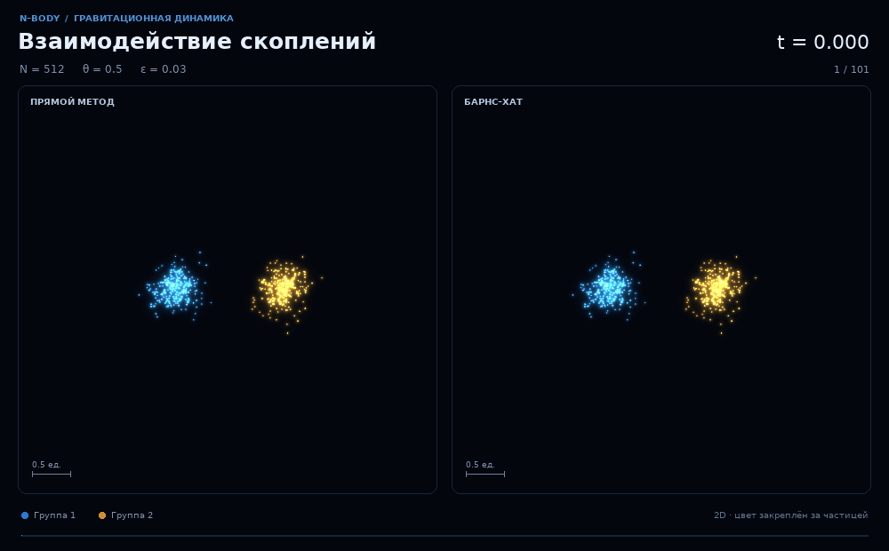

# N-BODY

**Гравитационная динамика · алгоритм Барнса–Хата**

Лабораторная работа № 2 по компьютерному моделированию


[Запуск](#быстрый-запуск) · [Анимации](#анимации) · [Параметры](#управление) · [Теория](#математическая-модель) · [Тесты](#структура-и-проверки)



*4096 частиц · Барнс–Хат · θ = 0,6 · ε = 0,03 · реальные координаты модели*

Программа рассчитывает взаимное притяжение частиц, строит их траектории и сравнивает прямое суммирование с методом Барнса–Хата. В анимации показаны два вращающихся диска на встречной орбите. Синий и золотой цвета сохраняют принадлежность частиц к исходным дискам; свечение и следы добавляются при отрисовке. Движение рассчитывается в плоскости, время и координаты безразмерны.

| Расчёт сил | Проверка модели | Визуализация |
|:---|:---|:---|
| Прямой метод **O(N²)** и дерево **O(N log N)** в типичном случае | Ошибка сил, энергия, импульсы и аналитическая орбита двух тел | Светящиеся частицы, сине-золотая палитра, GIF и PNG |

## Быстрый запуск

Нужен **Python 3.11–3.14**; проект проверен на Python 3.13. Откройте терминал в корне репозитория и создайте окружение.

**Windows / PowerShell**

```powershell
python -m venv .venv
.\.venv\Scripts\python.exe -m pip install -r requirements.txt
.\.venv\Scripts\python.exe main.py
```

### Linux и macOS

```bash
python3 -m venv .venv
.venv/bin/python -m pip install -r requirements.txt
.venv/bin/python main.py
```

Запуск без параметров выполняет полный учебный эксперимент: сравнение скорости и точности, моделирование обоими методами и проверку двух тел. Численные данные и рисунки сохраняются в `results/demo/`. Для GIF добавьте `demo --animate`.

Первый запуск компилирует функции Numba; следующие используют кэш. Для больших демонстраций и измерений времени программа должна напечатать `Вычислительный режим: numba`. Активация окружения не требуется.

### Запустить сцену с двумя дисками

```powershell
.\.venv\Scripts\python.exe main.py simulate `
  --scenario galaxies --n 4096 --method barnes-hut `
  --theta 0.6 --steps 800 --dt 0.0075 --sample-every 5 `
  --animate --theme cosmic --fps 24 --out results/galaxies
```

В `results/galaxies/` появятся `animation.gif`, `poster.png`, траектории и диагностики. Тема `cosmic` включает тёмный фон и свечение. Для светлых научных графиков используйте `--theme paper`.

## Анимации

### Прямой метод и Барнс–Хат на одинаковом состоянии



Слева — прямое суммирование, справа — Барнс–Хат при θ = 0,5. Оба расчёта начинаются с одинаковых координат, масс и скоростей. Цвета обозначают исходные группы частиц. Расхождение траекторий и ошибка сил исследуются отдельно.

```powershell
.\.venv\Scripts\python.exe main.py simulate `
  --scenario clusters --n 512 --method both `
  --steps 400 --dt 0.005 --sample-every 4 --theta 0.5 `
  --animate --theme cosmic --fps 24 --out results/comparison
```

### Как воспроизвести GIF из README

```powershell
.\.venv\Scripts\python.exe scripts/build_readme_media.py
```

Генератор интегрирует движение, сохраняет снимки в `results/readme_media/` и создаёт GIF в `docs/media/`. При повторном запуске использует кэш, если параметры и исходники модели совпадают. `--render-only` позволяет заново отрисовать готовые снимки; `--simulate-only` подготавливает только численные данные. Для отдельного примера добавьте `--only galaxies` или `--only comparison`.

Все параметры, seed, число кадров, длительность GIF и хеши исходников записаны в [docs/media/manifest.json](docs/media/manifest.json). Время GIF — время воспроизведения, а `model_time_final` в метаданных — безразмерное время модели. Новое измерение скорости может отличаться из-за фоновой нагрузки.

## Управление

| Команда | Результат |
|:---|:---|
| `simulate` | Движение частиц, GIF, траектории и законы сохранения |
| `benchmark` | Время и погрешность сил при разных N и θ |
| `validate` | Проверка круговой орбиты и второго порядка интегратора |
| `demo` | Полный учебный эксперимент; запускается по умолчанию |

### Примеры команд и полный список параметров

В командах ниже `python` означает интерпретатор из созданного окружения; можно везде подставить полный путь `.\.venv\Scripts\python.exe`.

```powershell
python main.py --help
python main.py simulate --help

# Одинаковые начальные условия, два метода, графики и GIF
python main.py simulate --n 500 --method both --theta 0.5 --steps 600 --dt 0.003 --animate

# Исследование зависимости времени от N и погрешности от theta
python main.py benchmark --sizes 128 256 512 1024 2048 4096 8192 --thetas 0.2 0.5 0.8 1.0 --repeats 5

# Второе распределение частиц для проверки влияния геометрии
python main.py benchmark --scenario clusters --out results/clusters

# Круговая орбита двух тел; можно отключить смягчение
python main.py simulate --scenario binary --n 2 --softening 0 --steps 2000 --dt 0.003 --sample-every 5
python main.py validate

# Полная демонстрация
python main.py demo --animate --out results/demo
```

`simulate`: `--n` — число частиц; `--method direct|barnes-hut|both`; `--theta` — порог раскрытия; `--dt` — шаг; `--steps` — число шагов; `--sample-every` — интервал сохранения и диагностик; `--seed` — начальное число генератора; `--scenario disk|clusters|binary|galaxies`; `--softening` — ε; `--g` — G; `--theme cosmic|paper` — оформление; `--fps` — частота GIF от 1 до 50 (по умолчанию 24); `--out` — каталог вывода. Суммарная масса стандартных наборов равна 1. Для binary требуется `--n 2`, для galaxies — не менее двух частиц.

`benchmark`: `--sizes` — список N; `--thetas` — список θ; `--repeats` — повторы измерения на одном снимке; `--scenario disk|clusters`, `--seed`, `--softening`, `--g`, `--out`. В каждой группе N используется отдельный детерминированный seed, сохранённый в метаданных. Повторы оценивают разброс времени, а не разброс ошибки между случайными реализациями. Для исследования последнего повторяйте эксперимент с разными `--seed` и разными `--out`.

Одинаковый `--out` перезаписывает одноимённые результаты. Коды завершения: 0 — успех, 1 — не пройдена физическая проверка `validate`, 2 — ошибка входных данных/файлов.

## Математическая модель

Ньютоновская гравитация со смягчением Пламмера, квадродерево и интегратор leapfrog. Частицы движутся в плоскости; сценарий `galaxies` задаёт два вращающихся экспоненциальных диска без тёмного гало и внешнего потенциала. Свечение и следы добавляются при отрисовке и не меняют рассчитанные траектории.

[Уравнения движения, допущения и численные методы →](docs/THEORY.md#математическая-модель)

## Как проводить исследование

Скорость сравнивается на одинаковых координатах и массах после прогрева Numba. Глобальная L2-ошибка и максимальная ошибка отдельной частицы характеризуют разные свойства приближения. В динамике дополнительно контролируются энергия, импульс и момент импульса.

[Полная методика, определения метрик и ограничения →](docs/THEORY.md#как-проводить-исследование)

## Входные и выходные данные

Начальные состояния и траектории сохраняются в NPZ, таблицы — в CSV, параметры и сводки — в JSON. Готовые PNG и GIF можно использовать для просмотра результатов.

### Собственные начальные условия и список выходных файлов

Для собственных данных подготовьте NPZ без Python-объектов:

```python
import numpy as np
np.savez("my_initial.npz",
         positions=np.array([[-0.5, 0.0], [0.5, 0.0]]),
         masses=np.array([0.5, 0.5]),
         velocities=np.array([[0.0, -0.5], [0.0, 0.5]]))
```

```powershell
python main.py simulate --input my_initial.npz --method both
```

`positions` и `velocities` имеют форму (N,2), `masses` — (N,); массы положительные, все числа конечные. Единицы всех массивов должны быть согласованы с G. `--input` заменяет генератор, поэтому `--n`, `--scenario` и `--seed` тогда не используются. Разрешены неравные массы. Сохранённый `initial_state.npz` можно подать на повторный запуск через `--input`.

| Файл | Содержание |
|---|---|
| `benchmark/benchmark.csv` | N, θ, времена, S, метрики ошибки сил |
| `benchmark/benchmark.png` | Время(N), ускорение(N), ошибка(θ), скорость/точность |
| `benchmark/benchmark_metadata.json` | Параметры, версии, backend, seed, все времена повторов |
| `benchmark/benchmark_summary.json` | Наклоны и переход к S>1 на измеренной сетке |
| `simulation/initial_state.npz` | Начальные координаты, массы, скорости |
| `simulation/trajectory_*.npz` | Времена, координаты и скорости (K,N,2), массы, диагностики и параметры |
| `simulation/diagnostics_*.csv` | Энергия, импульс, момент импульса и их изменения по времени |
| `simulation/trajectory_comparison.csv` | Взвешенное по массам RMS-различие координат (для both) |
| `simulation/trajectories.png` | Начальные/конечные положения и до 24 траекторий |
| `simulation/conservation.png` | Изменения энергии, импульса, момента импульса |
| `simulation/animation.gif` | Анимация при `--animate` |
| `simulation/poster.png` | Отдельный кадр визуализации |
| `simulation/config.json`, `simulation/simulation_summary.json` | Настройки и сводка расчёта |
| `validation/validation.json` | Ошибка круговой орбиты и проверка второго порядка |

Подкаталоги в таблице соответствуют `demo`; отдельные команды пишут прямо в свой `--out`. Снимки обязательно включают начальное и конечное состояния, даже если `steps` не кратно `sample_every`. Формат CSV — UTF-8 с BOM, разделитель запятая. NPZ читается через `np.load(path, allow_pickle=False)`. Графики сохраняются в PNG без необходимости открывать графическое окно.

## Структура и проверки

```text
.
├── main.py                     точка входа
├── nbody/
│   ├── forces.py               прямой метод и квадродерево
│   ├── simulation.py           начальные условия и leapfrog
│   ├── rendering.py            свечение, следы, кадры и GIF
│   ├── plots.py                траектории и законы сохранения
│   ├── experiments.py          измерения скорости и ошибок
│   └── cli.py                  команды и параметры
├── scripts/build_readme_media.py
├── docs/
│   ├── THEORY.md               уравнения, алгоритмы и методика экспериментов
│   └── media/                  GIF, постеры и параметры демонстраций
├── tests/                      физика, данные и новые сценарии
├── requirements.txt
├── requirements-dev.txt
└── README.md
```

```powershell
.\.venv\Scripts\python.exe -m pip install -r requirements-dev.txt
.\.venv\Scripts\python.exe -m pytest -q
```

Тесты проверяют аналитическую силу и энергию неравной пары; III закон Ньютона прямого метода; совпадение дерева с точной суммой при θ=0; самодействие; совпавшие частицы; некорректные данные; круговую орбиту; второй порядок по времени; сохранность входных массивов и конечного отсчёта.

Окружение, кэш и рабочие результаты исключены через `.gitignore`. Анимации в `docs/media/` публикуются вместе с README; для них сохранены параметры воспроизведения. Полученные CSV и рисунки можно использовать для самостоятельного анализа и оформления отчёта.

## Связь с материалами курса

Модель опирается на предоставленную лекцию «Компьютерное моделирование — 6»: материальные точки и уравнения движения — с.3; прямые взаимодействия — с.4; leapfrog — с.8; гравитация — с.14; масса/центр масс группы — с.15; адаптивное дерево и критерий s/d<θ — с.16–18. Время, метрики, ε и конкретные наборы N/θ выбраны в реализации и явно описаны выше.
